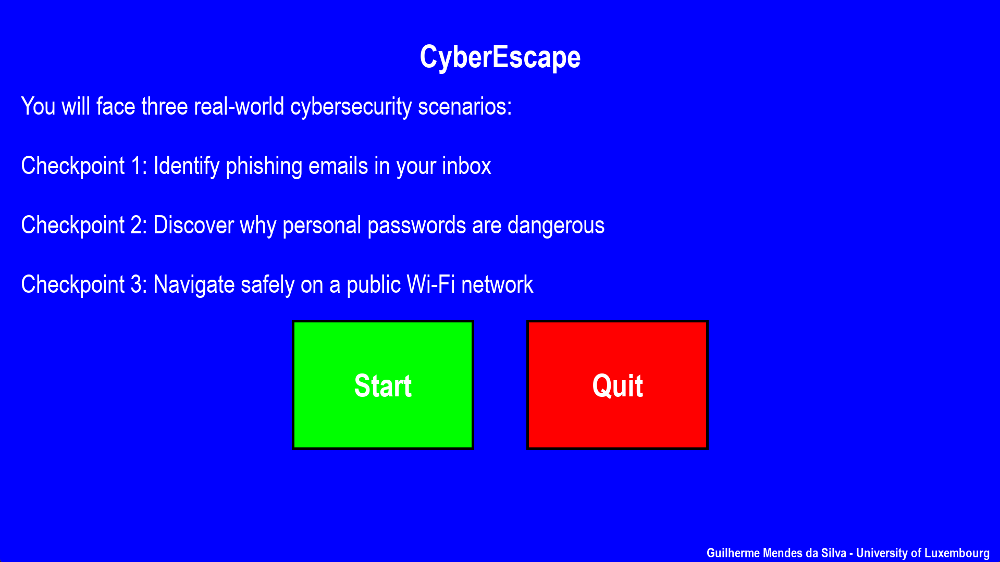
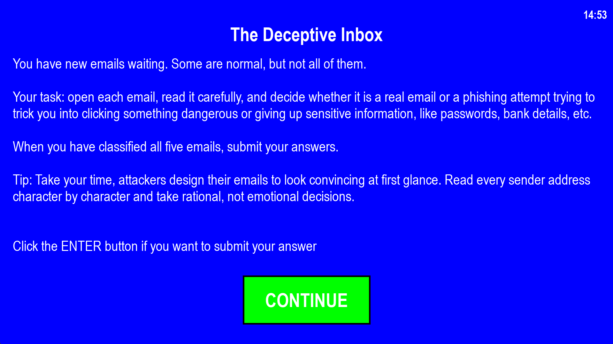
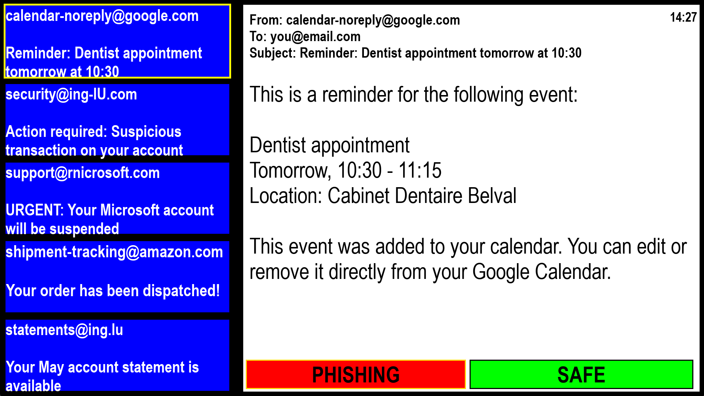
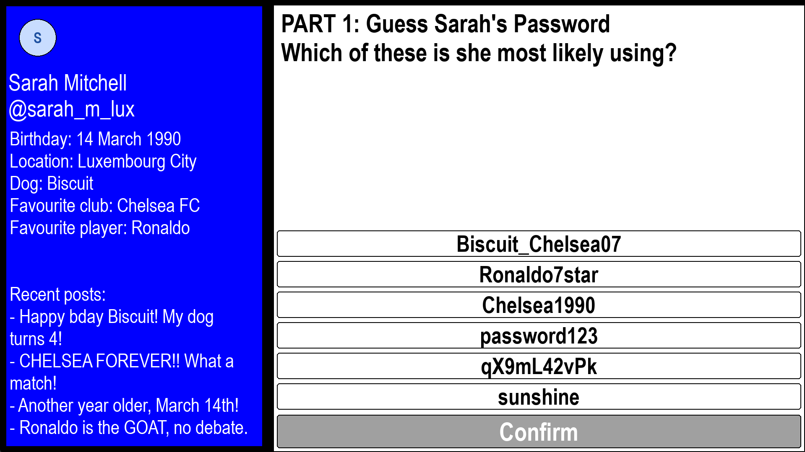
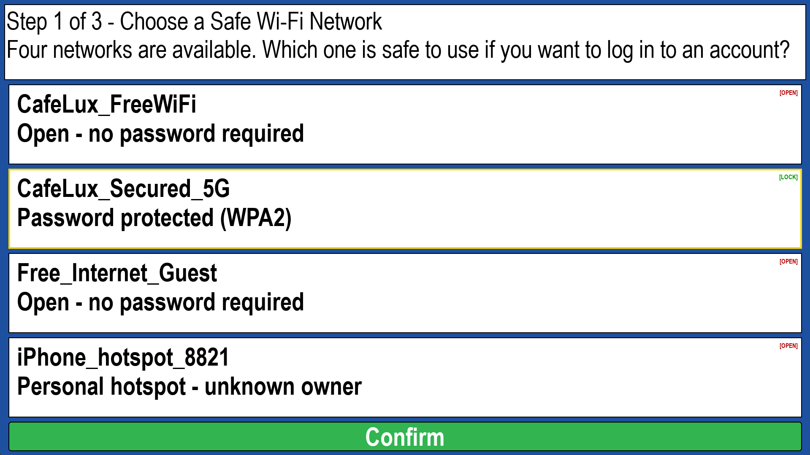
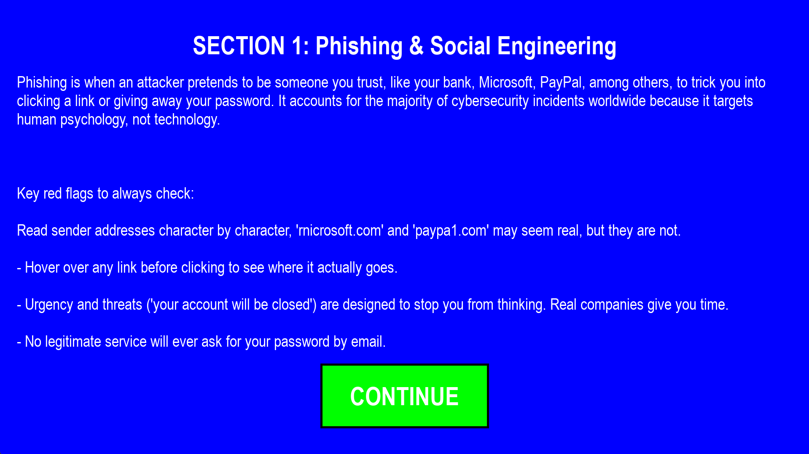

# CyberEscape

A digital educational escape room that teaches cybersecurity awareness to non-expert users. Built with Python and Pygame as a Bachelor Semester Project (BSP, 10 ECTS) at the University of Luxembourg, 2026.

> This is a prototype, not a full game. It demonstrates three short, sequential checkpoints, with the research and design reasoning documented in the report.

## What it is

The player works through three checkpoints, each built around a real attack type from the ENISA Threat Landscape 2025. Every checkpoint starts with an instruction screen explaining the scenario and ends with a short summary of what the player should take away.

1. **The Deceptive Inbox (phishing):** the player opens emails in an inbox, reads sender addresses and message bodies, and marks each one as PHISHING or SAFE. A wrong classification sends the player back to a fresh set of emails.
2. **The Profile Problem (password guessing):** the player sees a fictional person's public social media profile and has to guess which password she most likely uses, which shows how much attackers can learn from public information. In the second part, the player picks the one strong password out of four options.
3. **The Café Connection (network sniffing):** the player is on a public Wi-Fi network and goes through three steps: choose a safe Wi-Fi network, pick the safe website address, and mark six online actions as SAFE or RISKY.

The puzzle design follows the literature on educational escape rooms, serious games and game-based learning. The full reasoning, including threat selection, pedagogy and narrative, is in the report.

## Screenshots

| Menu | Checkpoint intro | Phishing |
|---|---|---|
|  |  |  |

| Password guessing | Public Wi-Fi | Summary |
|---|---|---|
|  |  |  |

## Run it

Requires Python 3.13 (other recent 3.x versions will probably work, but 3.13 is what it was built with).

```bash
git clone https://github.com/gmendesdasilva/CyberEscape.git
cd CyberEscape
python -m venv venv
```

Activate the virtual environment:

```bash
# Windows
venv\Scripts\activate

# macOS / Linux
source venv/bin/activate
```

Install the dependency and start the game from the project root:

```bash
pip install -r requirements.txt
python main.py
```

## Controls

- **Mouse (left click):** everything: menu buttons, selecting emails and answers, Confirm and Continue buttons.
- **Enter:** submits your answers in the phishing checkpoint.
- **Esc:** quits the game at any time.

Other behaviour to know about:

- The CONTINUE button on every instruction and summary screen unlocks after a 5 second countdown, so players actually read the text.
- A countdown timer runs in the top-right corner during the game. When it reaches zero, the game jumps to the summary screens.
- The window is created at the resolution of your display.

## Project structure

```
main.py                 entry point and state machine (menu, checkpoints, summaries)
States/
  Menu.py               start screen
  checkpoints.py        instruction and summary screens (shared by all checkpoints)
  puzzle1.py            checkpoint 1: phishing inbox
  puzzle2.py            checkpoint 2: password guessing and strong password choice
  puzzle3.py            checkpoint 3: public Wi-Fi, website address, safe actions
Constants/
  constants.py          screen settings, all instruction and summary texts,
                        and the data pools (emails, passwords, networks, URLs, actions)
txt_rect.py             helper that wraps text and fits it into a rectangle
docs/                   screenshots used in this README
report/                 LaTeX source and compiled PDF of the project report
```

The game uses no image or sound files. Everything is drawn with Pygame shapes and system fonts, and all puzzle content lives in `Constants/constants.py`.

## Scope and limitations

- Prototype with three sequential checkpoints, not a complete escape room.
- Puzzle content comes from fixed pools. The order of options is shuffled, and checkpoint 1 draws a random selection of legitimate emails, but the content itself does not change between runs.
- The visual design is deliberately simple: shapes and system fonts, no artwork, no sound.
- Layout is computed from the display resolution at launch, and unusual screen sizes have not been tested.
- The prototype has not been evaluated with real users, so any learning effect is not measured.
- Fonts (Arial and Courier) come from the operating system, so text may look slightly different on other systems.

## Report

The accompanying report is in [`report/`](report/): the compiled version is [`report/report.pdf`](report/report.pdf) and the LaTeX source is `report/main.tex`.

The report uses the ACM `acmart` template (sigconf format), available at https://ctan.org/pkg/acmart. See the package for its license terms. The class file, bibliography style and sample source are included unmodified.

## AI disclosure

In line with the University of Luxembourg guidelines on the use of generative AI tools for learning and teaching:

- **Claude** (Anthropic) was used for coding assistance and structural guidance.
- **NotebookLM** (Google) was used for source management and rephrasing.

All code and text were reviewed and adapted by the author.

## Author

Guilherme Mendes da Silva, BSc Computer Science, University of Luxembourg.
Supervised by Prof. Muriel Frank.

## License

The code is released under the [MIT License](LICENSE). You are free to use, modify and share it, as long as you keep the copyright notice (Guilherme Mendes da Silva) with it.

The report in `report/` is also by Guilherme Mendes da Silva. Please cite it if you reference it. The ACM template files in `report/` keep their own license.
